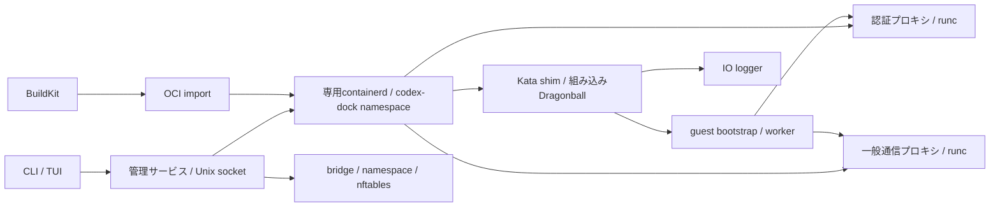

# アーキテクチャ

**日本語** | [English](en/architecture.md)

実行経路は **containerd → Kata runtime-rs → Dragonball** です。
CLIとTUIはroot管理サービスへ接続し、サービスが専用containerdを操作します。
イメージの作成には独立したBuildKitを使います。

## コードの責務

| 場所 | 責務 |
|---|---|
| `cmd/`、`internal/ui` | CLI、VM管理、TUI |
| `internal/sandbox` | ワーカー起動、検証ゲート、認証復元、mount、worktree、削除記録 |
| `internal/engine` | containerd SDKによるimage・snapshot・task管理、ネットワーク、継続するconsole I/O |
| `internal/kataguard` | 固定資産、予約台帳、ホストプロセス・資源制限の検証、孤児回収 |
| `internal/authproxy` | AI認証、トークン・管理API、HTTP/SSE/WS、一般通信の転送 |
| `internal/networkpolicy` | 宛先ルール、DNS応答の検査、検証済みIPへの接続 |
| `internal/template`、`internal/worktree` | イメージテンプレート、Git worktree |
| `docker/` | Dockerfile形式のイメージ資産。ビルドはBuildKit |
| `deploy/kata/` | ホスト配置、サービス設定、guest準備 |

CLIの既定接続先は `/run/codex-dock-node.sock` です。
Docker SDKの型とHTTPクライアントを内部互換層で利用しますが、Docker daemonには接続しません。
接続先は `CODEX_DOCK_KATA_NODE_SOCKET` で変更します。

## ワーカーを起動する流れ

1. 固定資産、containerd、cgroup v2を検証する。
2. 専用ネットワークとCPU・メモリ・PIDの上限を予約する。
3. OCI実行仕様を保存し、snapshotを用意する。
4. 信頼済みbootstrapをPID 1としてVMを起動し、利用者の処理は待機させる。
5. ホストのshim/loggerとcgroup、guestの別kernel・実行ユーザー・権限・資源制限を照合する。
6. 短命トークンを有効にし、nonceで元のentrypointを解放する。

認証プロキシだけが実認証情報を注入します。
一般通信プロキシは実認証情報を持ちません。
`--no-internet` は一般通信プロキシを接続せず、固定AI経路だけを維持します。

## 状態を保存する場所

| 保存先 | 内容 |
|---|---|
| `/var/lib/codex-dock-node/allocations` | root所有のVM予約台帳 |
| `/var/lib/codex-dock-node/engine` | 実行仕様、network、ログ |
| `/var/lib/codex-dock-containerd` | containerdの永続状態 |
| `/run/codex-dock-containerd` | containerdの実行時状態 |

停止したコンテナとsnapshotは保持し、再起動には同じIDを使います。
ログ収集とstdinの維持はshim側のloggerが担当するため、管理サービスを再起動してもVMとI/Oを維持します。

削除予定を先に永続化し、network・token・cgroup・worktreeの回収に失敗した場合は再試行できるようにします。
所有関係を確認できる資源だけを扱い、管理層に接続できない状態を孤児として削除しません。

配置は[Kataの準備](kata.md)、境界は[セキュリティ](security.md)、照合は[VM管理](vm.md)を参照してください。
