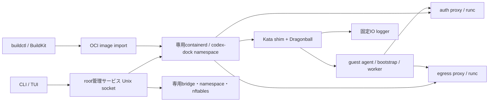

# アーキテクチャ概要

既定構成はcontainerd・Kata runtime-rs・Dragonball。Docker daemonとDocker CLIを実行時依存から外し、既存の操作画面と認証・worktreeの機能を維持する。[配置と移行](kata.md)、[ネットワーク](network.md)、[VM管理](vm.md)も参照。

## コードの責務

| 場所 | 責務 |
|---|---|
| `cmd/`、`internal/ui` | 既存CLI、VM管理、TUI |
| `internal/sandbox` | ワーカー作成、起動ゲート、認証復元、workspace/worktree、削除journal |
| `internal/engine/backend.go` | 公式containerd SDKによるimage・snapshot・task管理。既存DTO用の限定HTTP互換層 |
| `internal/engine/network*.go` | ホストの専用bridge・namespace・IP予約・nftables検証と復元 |
| `internal/engine/io.go`、`cmd/io-logger` | shim所有のログ収集とstdin維持。node再起動でguest I/Oを切断しない |
| `internal/kataguard` | root予約台帳、固定資産と実プロセス検証、ホスト資源制限、孤児回収 |
| `internal/authproxy` | OpenAI/Anthropic reverse、token/admin、egress forward、WebSocket等を分離したモジュール |
| `internal/networkpolicy` | 宛先domain/IP/CIDR/portの許可・拒否、DNS応答検査とdial固定 |
| `internal/template`、`internal/worktree` | imageテンプレート、Git worktree管理 |
| `docker/` | 既存Dockerfile形式のimage資産。ビルドは独立BuildKit |

## ワーカーの起動

1. 固定したKata資産、実containerdプロセス、cgroup v2を検証する。
2. ワーカー専用networkを予約し、必要なproxyだけを追加接続する。既存nameを新しいworkerとして採用しない。
3. CPU・メモリ・PIDのホスト上限を予約し、private台帳へ永続化する。
4. image設定と利用者の選択からOCI specを作り、snapshotと生成前specを保存する。UID/GID、capability削除、seccomp、NNP、read-only cgroup mountを明示する。
5. Dragonball VMで固定bootstrapをPID 1として起動する。imageのentrypointや利用者コードはまだ動かさない。
6. ホストの実shim/logger inode・worker ID・所属・資源上限と、guestの別kernel、UID/GID、capability、seccomp、NNP、資源制限を確認する。
7. 認証placeholderをproxyへ復元し、nonceによって元のentrypointを解放する。guestはproxyからplaceholderだけを取得する。

APIリクエストの実資格情報への置換はauth proxyだけが行う。一般通信は資格情報を持たないegress proxyが担当する。`--no-internet` はegress proxyを接続しない。

## 停止・再起動・削除

コンテナとsnapshotはcontainerdに保持し、再起動時も同じIDを使う。Dragonballの自己cgroup削除と残存tcfilterには[Kata固有の回収処理](kata.md)を適用する。tokenの失効・復元、Gitメタデータの同一絶対パス共有、readonly mount、worktreeの回収は既存Managerが担当する。

削除のintentは実オブジェクトを消す前にfsyncする。失敗時はnetwork・token・cgroup・worktreeを再試行できる。nodeは自身のnamespace・所有ID・専用資源だけを扱い、不明状態を孤児として削除しない。root管理socketを利用するhost operatorはroot相当であり、guestには公開しない。
