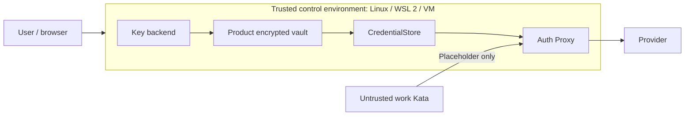

# ケース別の認証と実行ID

[English](en/credential-store.md) | **日本語**

同じホストで複数の利用者やケースを扱う製品は、ケースごとに独立した認証プロキシを使えます。実資格情報は製品の保存先とホスト側プロキシだけに置き、ワーカーVMには短命トークンだけを渡します。既存のCLI用プロキシは引き続き利用できます。

## 製品側の保存契約

製品は `pkg/cxd/credentialstore.Store` を実装します。`Load(ctx, caseID)` は現在の資格情報と `Version`、`ConnectionVersion` を返します。`SaveRefresh(ctx, caseID, expectedVersion, provider, next)` は、保存先で版を原子的に比較し、OAuth更新結果を永続化した後に新しい `Version` を返してください。再ログイン・接続解除・別の更新で版が変わった場合は `credentialstore.ErrConflict` または `ErrNotFound` を返します。資格情報をログへ書かないでください。

`ConnectionVersion` は再ログインなどの接続世代です。OAuthの通常更新では維持し、接続の入れ替え時に変更します。`Version` は更新ごとに変更します。両方を混同すると、古い更新を保存したり、正常な更新後の実行を不要に止めたりします。

`credentialstore.Serve(ctx, socketPath, caseID, store)` が一つのケースだけを扱うホスト内のUnixソケットを提供します。ケースごとに別のソケットを立ててください。親ディレクトリは実行ユーザー所有の `0700`、ソケットは `0600` です。製品DBの暗号化、利用者の認可、ケースIDと実行IDの割り当ては製品が担当します。

## 起動と実行

1. ケースごとに一意のプロキシ名・ホスト管理ポート・管理シークレットを割り当てます。管理シークレットは32文字以上とし、ホストで保持します。
2. `cxd.EnsureCaseProxy(ctx, cxd.CaseProxyOptions{NodeSocket: nodeSocket, Name: "cxd-user-a", CaseID: "user-a", StoreSocket: socketPath, AdminPort: 18181, AdminSecret: secret})` を呼びます。資格情報ソケットは該当プロキシにのみマウントされ、VMには渡されません。互換する `codex-dock-proxy:latest` イメージを事前にビルドしてください。
3. 戻り値の `AdminURL`、`ContainerURL` と同じシークレットを `cxd.Open` の `Options` に指定します。`LaunchRequest.Identity` に `identity.Identity{CaseID: "user-a", RunID: "run-1", ConnectionVersion: "v1", Provider: "openai"}` を入れます。`RequestID` にケース・実行・試行・接続世代を含め、同じ試行の再送では変更しません。
4. 取消時は `client.RevokeRun(ctx, id)` で新規要求と実行中のストリームを止め、`Stop` と `Remove` でVMを回収します。接続解除時は `client.RevokeCase(ctx)` を呼び、全ワーカーを回収します。そのケースで新規起動がない状態で `cxd.RemoveCaseProxy(ctx, nodeSocket, proxy.Name, caseID)` を呼びます。参照するワーカーが残る間は削除を拒否します。

ケースAとケースBは別のプロキシ、別の管理シークレット、別の資格情報ソケット、別の管理ポートを使ってください。`EnsureCaseProxy` は既存コンテナのケースIDのダイジェスト、イメージ、ソケット、管理ポートを照合します。プロキシ再起動時は保存先から資格情報を再取得します。接続世代や資格情報版が変わった場合、旧プロキシは新規トークンを拒否します。OAuth保存失敗時もケースを失効させます。

`Identity.Provider` は `openai` または `anthropic` で、プロキシは該当するAPI経路だけを許可します。`CaseProxyOptions.AllowedModels` に正確な上流モデルIDの許可リストを渡すと、認証済みのAI要求のJSON本文を上流接続・秘密注入前に検査します。空リストは従来通り制限しません。詳細と対応経路は[追加制御](sandbox-features.md#モデル認可と段階的な起動)を参照してください。一般通信のワーカー別ドメイン許可は[通信ポリシー](proxy-policy.md)で設定します。ポリシーを変更する場合は新しいワーカーを起動してください。

ケース別プロキシはオプトインです。既存のホストHOME認証ファイルを使うCLIフローは変わりません。ケース別プロキシではHOME認証ファイルやローカルOAuth状態を読みません。管理ポートにはローカルホストからのみ接続し、管理シークレットをワーカーやプロジェクト設定へ渡さないでください。

OAuth保存失敗時は新規要求と通信中streamを失効させます。保存先が復旧しても、上流でrefresh tokenが既に回転している可能性があります。製品側で再ログインなどの復旧と接続世代の整合性を確認し、古い実行を暗黙に再認可しないでください。proxy再起動だけで資格情報が復旧する保証はありません。

公式Claude Codeのサブスクでは、`AnthropicOAuth` にaccess tokenだけのsetup-tokenを指定でき、`RefreshToken` は省略可能です。その場合、期限切れ時は製品側で資格情報を再発行し再接続します。refresh tokenと既知の期限を持つログインは、更新結果をCAS保存してから使います。[Claude Code](claude-code.md)を参照してください。

## 初期実装：0600ファイル保存

`credentialstore.NewFileStore(directory)` は、将来のVaultと同じ`Store`契約を持つ平文ファイル実装です。保存ディレクトリは実行ユーザー所有の`0700`、各`<profile>.json`とlockファイルは`0600`です。権限不備・symlink・hardlink・不正なprofile名を拒否し、ホストCLIや認証用環境変数にはfallbackしません。

`Create(ctx, name, credentials)` は新しい資格情報版と接続世代を生成し、既存profileを上書きしません。`Load`と`SaveRefresh`はプロセス間lockを使い、更新は期待する版を比較してから一時ファイル・fsync・atomic renameで保存します。別providerや接続世代をRefreshで変更できません。保存後のディレクトリfsyncで失敗した場合など、更新結果が不確実な失敗はProxy側で実行を失効させる既存契約に従います。

この実装は暗号化しません。WSLではLinux側の私有ディレクトリを使い、共有フォルダー・バックアップからの秘密保護は別途必要です。ファイル版Storeを利用する場合も、上記のケース別Unix socketを通じてAuth Proxyだけに公開できます。

CLIの[独立プロファイル](commands/auth.md#独立プロファイル)はこのFileStoreを使用します。`auth profile set/import/show/list` と `--auth-profile` を提供し、選択した場合はホスト認証へfallbackしません。各プロファイルを別のディレクトリへ保存し、選択したディレクトリだけをAuth Proxyへ読み書き可能で渡します。OAuth更新も同じStoreへ永続化し、Proxy再起動時はそこから読み直します。保持したworkerには名前と接続世代を記録し、別ログインへの再開を拒否します。ファイル版からVaultへ変更する際は `Store` 実装を差し替え、同じ適合性試験を使う設計です。Vault自体と自動移行は未実装です。

CLIはprofile領域とworkspace・clone・追加mountの重複を拒否します。組み込みAPIの利用者も、Storeと管理シークレットをworkerの共有領域外へ置いてください。作成・importは新規限定で、再ログイン時は旧workerの停止・削除とProxy再作成を明示的に行います。

## 独立した認証管理の設計要件：WSL・VM・ヘッドレス

この節は今後の製品内Vaultの要件です。暗号化Vault、鍵backend、解除UI、専用loginフローは未実装です。初期のFileStoreと、既存の製品APIキーファイル・ローカルOAuth更新状態は権限制限付きの平文です。外部Storeの暗号化は組み込み側が担当します。

### 制御環境と作業VMを分ける

ここでいう「ホスト」は、製品のController・Vault・認証Proxyを運用する信頼済み環境です。物理Linuxに加え、WSL 2や通常のLinux VM内に置く構成も設計対象とします。「作業VMへ実資格情報を渡さない」という条件は、任意コードを実行するworkerを対象とし、制御環境が仮想化されていることを禁止する意味ではありません。

製品専用profileと鍵namespaceを使い、ホストCLIのログイン、Windowsのユーザー環境、継承環境変数を自動流用しません。作業VMにはVault・解除鍵・資格情報socket・制御環境のHOMEを渡しません。外側のWindows管理者・WSLを所有するWindows利用者・hypervisor管理者・制御環境のrootは信頼対象です。WSLのLinux側ファイルもWindowsの同一利用者のプロセスからアクセスされ得ます。同一UIDの悪意あるプロセスや制御環境のメモリ読取まで、保存暗号化だけで防げるとは扱いません。

### 鍵の保管と解除

暗号化ファイル形式と鍵の解除方式を分けます。ランダムなデータ暗号鍵をAEADで使い、profile・provider・schemaを認証付きメタデータへ結び付けます。鍵は選択したbackendで保護し、同じディレクトリの平文鍵による自動解除は提供しません。

| 制御環境 | 設計上の解除方式 | 前提・扱い |
|---|---|---|
| Linux desktop | 利用可能なSecret Service、または明示パスフレーズ | backendの存在・利用者セッション・lock状態を実際に確認 |
| WSL 2 | 明示パスフレーズを基本経路とし、Secret Serviceは利用可能な場合だけ選択可能 | Windowsとの資格情報共有・systemd・GUI・D-Busを必須条件にしない |
| Linux VM・SSH・ヘッドレス | 明示パスフレーズ。無人解除は別途明示設定した保護経路のみ | TPM・vTPM・デスクトップkeyringがなくても設計を成立させる |
| Windows側の鍵保護との連携 | 将来の任意backendとして検討 | ユーザースコープのDPAPIと限定helperの認可・移行を検証してから提供。初期実装の必須条件にしない |

Secret ServiceはユーザーのD-Busセッションを使い、lockやpromptを扱います。systemdの起動だけでkeyringの利用可能性を判断しません。根拠は[Secret Service仕様](https://specifications.freedesktop.org/secret-service/latest-single/)と[WSLのsystemd資料](https://learn.microsoft.com/en-us/windows/wsl/systemd)です。DPAPIは通常、利用者・マシンに依存するため、VM複製や再インストールで同じ鍵を使える前提にしません。[Microsoftの仕様](https://learn.microsoft.com/en-us/windows/win32/api/dpapi/nf-dpapi-cryptprotectdata)を参照してください。

パスフレーズは非表示TTYまたは明示的な専用入力FDで受け取り、argv・環境変数・通常ログには載せません。導出にはArgon2id等の既存実装を使い、saltとKDFパラメーターを記録します。小さいVMでのメモリ／時間予算を測定し、保存ファイルが指定するパラメーターにも上限を設けます。KDFは解除・パスフレーズ変更時に限定し、通常の推論やOAuth更新ごとには実行しません。

初期設定でbackendを明示選択し、既存Vaultのbackendが消えた・ロックされた場合は解除待ち／利用不能として停止します。別backend・ホスト認証・平文保存へ自動切替しません。TTYのない処理は入力待ちで停止させず、解除が必要であることを返します。backend変更は、旧方式での解除後に鍵を再保護して永続化し、成功後だけ切り替えます。鍵紛失は新規空Vaultの作成で成功扱いにしません。

### 保存場所・復旧・ログイン

WSLではLinux側のファイルシステムへ製品専用の保存領域を置きます。`/mnt/c`等のDrvFSや共有フォルダーについて、`chmod 0600`だけで保護できるとは判定しません。[WSLの権限仕様](https://learn.microsoft.com/en-us/windows/wsl/file-permissions)を踏まえ、実体のfilesystem・所有者・権限・socket・atomic rename／fsyncの保証を確認し、未検証の保存先は既定で拒否します。鍵と暗号文を同じ共有・同期フォルダーへ平文で並べません。

WSL export、VMの複製・バックアップ、ディスクsnapshotには保存状態が含まれ得ます。暗号文と解除手段を分けて管理し、移行先では明示的な復旧手順を使います。実行中の制御VMのメモリsnapshotや休止イメージには復号済みの秘密が含まれ得るため、Vaultの保存暗号化で保護済みとは扱いません。バックアップのために秘密を除く場合は、Proxy等の資格情報利用プロセスを終了した状態を前提にします。

旧Refresh tokenや既存workerのleaseを復元して自動再開しません。明示的な復旧・複製では再認証と新しい接続世代で再開し、旧実行を再認可しない方針です。外側のsnapshotでVault・鍵・世代台帳ごと巻き戻された場合、独立した信頼できる世代情報がなければ巻き戻りの完全検知は保証できません。AEADやローカルCASだけで防げるとは説明しません。

鍵のlockだけではProxyが保持する実トークンは消えません。製品の明示lock／logoutは、新規発行停止、既存lease・stream失効、資格情報利用プロセスの停止・状態破棄までを一つの操作として設計します。ホストのswap・core dump・外側のsnapshotは別の保護対象です。

制御環境にブラウザがない場合も、公式のdevice／headlessフローや明示的に保護したcallback経路を使い、別端末の利用者ブラウザで認証できる設計にします。外側ブラウザの`localhost`とWSL／VM内の`localhost`が同じとは仮定せず、callbackや管理portをLAN全体へ公開しません。認証専用Kataは固定CLI・一時メモリ状態でloginだけを行い、workspace・hooks・plugin・通常console記録を与えません。許可された方式の資格情報移送と永続化が完了した後、成功・取消・失敗のいずれでも一時状態を破棄します。provider条件と整合しないtoken抽出・保管は対応を保留します。

認証保存の可搬性とKata実行の可否は別です。WSL／VMでのKata対応は、nested virtualization・`/dev/kvm`・起動ゲートを実機で検証して判断し、認証backendが動いたことだけで対応済みとしません。検証失敗時に隔離の弱いruntimeへ自動fallbackしない方針を維持します。

### 実装時の受入条件

- D-Bus／Secret Service／systemd／TPMがない構成で、パスフレーズによる初期化・解除・保存・再起動後の再解除を確認する。
- keyringのlock・セッション切断・誤ったパスフレーズ・鍵紛失・backend変更途中の取消で、平文やホスト認証へ切り替わらないことを確認する。
- WSLのLinux filesystemとDrvFS、VMの共有filesystemを区別し、権限・socket・永続化の保証がない保存先を拒否する。
- WSL停止・再起動、VM休止・再開、ブラウザが別端末のlogin、同時Refresh、容量不足、保存失敗を検証する。
- 明示的なbackup復旧・複製で旧接続を自動再認可せず、未検知の外側rollbackに対する保証の限界を記録する。
- 既存のStore適合試験と資格情報非漏出試験を再利用し、作業VMのenv・ファイル・ログ・checkpointへ実秘密が出ないことを確認する。これらのWSL／VM固有の受入は未実施。
