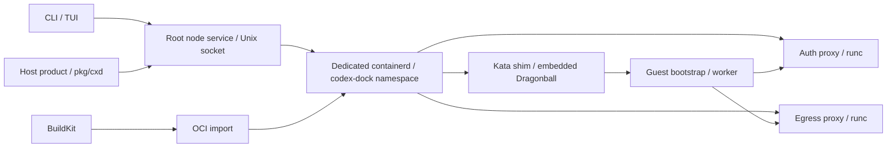

# Architecture

[日本語](../architecture.md) | **English**

- The default execution path is **containerd → Kata runtime-rs → Dragonball**.
- Images keep the OCI/Dockerfile format and are built with standalone BuildKit.

## Responsibilities

| Component | Purpose |
|---|---|
| `cmd/`, `internal/ui` | CLI and TUI |
| `pkg/cxd` | [Local Go API](go-api.md) for product integration: idempotent launch reconciliation, execution, cleanup, and image preparation through BuildKit |
| `internal/sandbox` | Worker lifecycle, bootstrap gate, tokens, mounts, worktrees, deletion journal |
| `internal/engine` | Containerd SDK, image/snapshot/task management, native networks, persistent console I/O |
| `internal/kataguard` | Pinned assets, VM allocations, host process and resource verification, orphan recovery |
| `internal/authproxy` | AI authentication, token/admin API, reverse HTTP/SSE/WS, general forward proxy |
| `internal/networkpolicy` | Destination rules, DNS response checks, dialing verified IPs |
| `internal/template`, `internal/worktree` | Image templates and Git worktrees |

- The CLI connects to `/run/codex-dock-node.sock`.
- The Go API uses the same socket and starts no extra listener.
- A durable node ledger reconciles launch request IDs after lost responses or retries to prevent duplicate workers.
- `CODEX_DOCK_KATA_NODE_SOCKET` selects another absolute socket path; `DOCKER_HOST` and Docker contexts are not used.
- The Docker SDK remains an internal DTO/HTTP compatibility dependency, not a Docker daemon dependency.

## Startup gate

1. Verify pinned assets, containerd and cgroup v2.
2. Reserve a private worker network and a host resource envelope.
3. Store the OCI specification and create the snapshot.
4. Boot a VM with the trusted guard as PID 1.

    - Keep user code waiting.

5. Check the host shim/logger, worker ID and cgroup limits, then the guest kernel, user, capabilities, seccomp and resource limits.
6. Activate the placeholder token and release the original entrypoint with a nonce.

- Shared workspaces use inline virtio-fs with `virtio_fs_cache = "none"` and `open,no_writeback_cache`.
- The node rejects old `auto`/`always` profiles to avoid stale host edits.
- Regenerate the profile and manifest when upgrading.

- Only the auth proxy injects real credentials.
- The egress proxy has no credentials.
- `--no-internet` leaves the egress proxy disconnected while keeping fixed AI routes available.

## Verification and authentication work

- Each asset validation rereads and checks every file with at most `min(4, GOMAXPROCS)` concurrent readers.
- It does not reuse verification results based on file timestamps, and the host/guest verification gate remains enforced.
- The auth proxy uses a token-value index to find issuance records, updating it under the same lock as issuance, restore and revocation.
- See [performance and benchmarks](performance.md) for measurement scope and comparison steps, and the [measurement record](../testing.md#2026-10-21の性能計測) (Japanese) for results.

## State and recovery

- Stopped containers and snapshots remain in containerd.
- Restart uses the same ID.
- The node stores allocations and engine state under `/var/lib/codex-dock-node`.
- Console I/O is owned by the shim so restarting the node service does not stop the guest or its logs.

- Stop records the exit code and time from containerd's exit notification.
- When waiting for a running task to exit, a failed notification or a channel closed without a result remains an error.
- Task deletion retains stopped/absent checks.
- Before releasing guest user code, reattaching a worker, or waiting for stop, Kata supervisor processes are verified and moved to a sibling cgroup within the same resource limits.

- Deletion intent is persisted before resources are removed.
- Failed cleanup can be retried.
- The node only manages resources whose ownership it can verify.
- When containerd cannot be queried, inventory reports `unknown` rather than treating resources as orphans.

See [security](security.md), [network](network.md) and [host setup](../kata.md) (Japanese).
