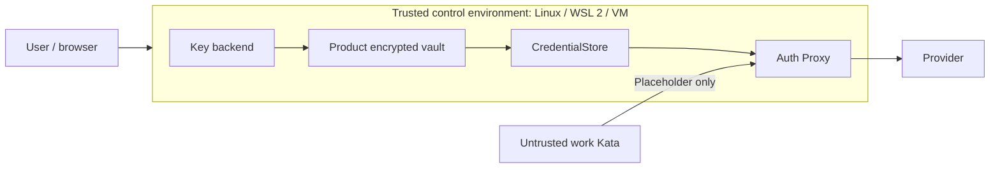

# Case-scoped credentials and run identity

**English** | [日本語](../credential-store.md)

- A host product serving multiple users or cases can run a separate auth proxy for each case.
- Real credentials stay in the product store and host proxy; worker VMs receive only short-lived tokens.
- The existing CLI proxy remains available.

| Component | Status |
|---|---|
| 0600 FileStore, independent profiles and auth-proxy integration | Implemented |
| Encrypted vault, key backends, unlock UI and dedicated login flow | Not implemented; requirements appear below |
| Real credentials in work VMs | Never provided; short-lived tokens only |

## Store contract

**Interface: `pkg/cxd/credentialstore.Store`.**

| Operation or result | Durable-store contract |
|---|---|
| `Load(ctx, caseID)` | Return current credentials, `Version` and `ConnectionVersion` |
| `SaveRefresh(ctx, caseID, expectedVersion, provider, next)` | Atomically compare the expected version and persist the OAuth refresh |
| Successful save | Return a new `Version` only after durable commit |
| Login replacement, disconnect or competing refresh | Return `credentialstore.ErrConflict` or `ErrNotFound` |
| Logs | Never log credential arguments |

### Keep the two versions separate

| Version | Normal OAuth refresh | Connection replacement |
|---|---|---|
| `Version` | Change after each update | Change |
| `ConnectionVersion` | Preserve | Change |

- The product owns DB encryption, user authorization and case-to-run mapping.

### Expose one case per socket

| Item | Requirement |
|---|---|
| API | `credentialstore.Serve(ctx, socketPath, caseID, store)` |
| Scope | One case over a host Unix socket |
| Case separation | Separate socket per case |
| Parent directory | Owned by the process user, mode `0700` |
| Socket | Mode `0600` |

## Startup and execution

1. Allocate a unique proxy name, host admin port, and admin secret of at least 32 characters per case.
2. Call `cxd.EnsureCaseProxy(ctx, cxd.CaseProxyOptions{NodeSocket: nodeSocket, Name: "cxd-user-a", CaseID: "user-a", StoreSocket: socketPath, AdminPort: 18181, AdminSecret: secret})`.

    - Build a matching `codex-dock-proxy:latest` image first.
    - Only the case proxy receives the credential socket mount; the VM does not.

3. Pass the returned `AdminURL` and `ContainerURL`, plus the secret, to `cxd.Open` in `Options`.

    - Set `LaunchRequest.Identity` to `identity.Identity{CaseID: "user-a", RunID: "run-1", ConnectionVersion: "v1", Provider: "openai"}`.
    - Include case, run, attempt, and connection generation in `RequestID`; keep it unchanged on retries of that attempt.

4. On cancellation, call `client.RevokeRun(ctx, id)` to stop new requests and active streams, then `Stop` and `Remove` the worker.

    - On disconnection, call `client.RevokeCase(ctx)`, remove all workers, stop new launches for that case, and call `cxd.RemoveCaseProxy(ctx, nodeSocket, proxy.Name, caseID)`.
    - Removal rejects a proxy referenced by a retained worker.

### Case separation and restart

- Use separate proxies, admin secrets, credential sockets, and admin ports for case A and case B.
- `EnsureCaseProxy` verifies an existing container's case digest, image, socket, and admin port.
- After restart, the proxy reloads credentials from the store.
- A changed credential or connection version revokes old issuance; a failed OAuth save revokes the case.

### Provider, model and egress authorization

- `Identity.Provider` is `openai` or `anthropic` and restricts the proxy to that provider's API routes.
- `CaseProxyOptions.AllowedModels` optionally restricts authenticated AI requests to exact upstream model IDs, checking their JSON body before upstream I/O or credential injection.
- Empty preserves unrestricted forwarding.
- See [additional controls](sandbox-features.md#model-authorization-and-staged-startup) for supported routes and limitations.
- Per-worker general egress allowlists are described in [network policy](../proxy-policy.md); changes require a new worker.

### Host credential separation

- Case proxies are opt-in.
- The existing CLI flow using host HOME credentials is unchanged.
- A case proxy does not read HOME credentials or local OAuth state.
- Keep its admin port on loopback and never pass the admin secret to a worker or project configuration.

### Recovery after a save failure

- OAuth save failures revoke new requests and active stream leases.
- Storage recovery alone may not restore a refresh token already rotated upstream.
- The product must reconcile credentials/connection generation, including re-login if needed, and must not silently reauthorize old runs.
- Restarting the proxy alone does not guarantee credential recovery.

### Claude subscription credentials

- For official Claude Code subscriptions, `AnthropicOAuth` accepts an access-only setup-token record without `RefreshToken`.
- Expiry then requires host-side credential replacement and reconnection.
- A login record with a refresh token and known expiry is refreshed and saved with CAS before use.
- See [Claude Code](claude-code.md).

## Initial implementation: 0600 files

- `credentialstore.NewFileStore(directory)` implements the same `Store` contract as a future vault, using plaintext files.
- Its directory must be owned by the process user with mode `0700`; each `<profile>.json` and lock file uses `0600`.
- It rejects unsafe permissions, symlinks, hardlinks and invalid names, without host CLI or authentication-environment fallback.

### Creation and refresh persistence

- `Create(ctx, name, credentials)` generates new credential and connection versions and never overwrites an existing profile.
- `Load` and `SaveRefresh` use a cross-process lock.
- Refresh compares the expected version before persisting through a temporary file, fsync and atomic rename.
- Refresh cannot change another provider or the connection generation.
- Ambiguous persistence failures, including a directory-fsync failure after rename, follow the existing proxy contract that revokes affected runs.

### Storage and encryption scope

- This backend does not encrypt secrets.
- In WSL, use a private Linux-side directory; shared folders and backups need separate protection.
- FileStore can also serve a case-scoped Unix socket mounted only into its auth proxy as described above.

### CLI integration

- The CLI's [independent profiles](commands/auth.md#independent-profiles) use FileStore through `auth profile set/import/show/list` and explicit `--auth-profile`.
- Selection disables host credential fallback.
- Each profile has a separate directory; only the selected directory is mounted read-write into its auth proxy.
- OAuth refresh persists there and proxy restarts reload it.
- Retained workers record the profile and connection generation, rejecting restart under another login.
- A future vault replaces the Store implementation while preserving its conformance tests; neither the vault nor automatic migration is implemented.

- The CLI rejects overlaps between profile storage and workspace, clone or extra mounts.
- Embedding API callers must also keep Store data and admin authority outside worker shares.
- Creation/import is create-only; re-login requires explicitly stopping/removing old workers and recreating the proxy.

## Independent credential management: WSL, VMs and headless systems

- This section specifies future product-vault requirements.
- The encrypted vault, key backends, unlock UI and dedicated login flow are not implemented.
- The initial FileStore, existing product API-key files and local OAuth rotation state are permission-restricted plaintext.
- External Store encryption belongs to the embedding product.

### Separate control environments from work VMs

- The trusted control environment owns the Controller, Vault and auth proxy.
- Its design targets include physical Linux, WSL 2 and Linux VMs.
- The rule against real credentials in work VMs concerns workers running arbitrary code; it does not prohibit running the trusted control environment inside a VM.

- Use product-specific profiles and key namespaces without automatically importing host CLI logins, Windows user credentials or inherited authentication variables.
- Workers must not receive the vault, unlock keys, credential sockets or control-environment HOME.
- Windows administrators, the Windows user owning the WSL distribution, hypervisor administrators and control-environment root remain trusted.
- Windows processes under that user can access WSL Linux files.
- At-rest encryption does not protect an unlocked process from a malicious same-UID process or memory access by its host.

### Key storage and unlocking

- Separate the encrypted file format from the key backend.
- Use a random data key with AEAD and authenticate the profile, provider and schema as associated metadata.
- Protect that key with the chosen backend; do not implement automatic unlocking through a plaintext key beside the ciphertext.

| Control environment | Planned unlock path | Requirement |
|---|---|---|
| Linux desktop | Available Secret Service or explicit passphrase | Check the backend, user session and lock state |
| WSL 2 | Explicit passphrase as a standard path; optional available Secret Service | No mandatory Windows credential sharing, systemd, GUI or D-Bus |
| Linux VM, SSH or headless | Explicit passphrase; unattended unlock only through an explicitly configured protected channel | No mandatory TPM, vTPM or desktop keyring |
| Windows key protection integration | Potential optional backend | Validate user-scoped DPAPI, narrow helper authorization and migration before providing it; not required initially |

- [Secret Service](https://specifications.freedesktop.org/secret-service/latest-single/) uses a user D-Bus session and can require unlocking or prompting.
- A running systemd does not establish keyring availability; see [WSL systemd documentation](https://learn.microsoft.com/en-us/windows/wsl/systemd).
- [DPAPI](https://learn.microsoft.com/en-us/windows/win32/api/dpapi/nf-dpapi-cryptprotectdata) usually depends on the user and machine, so cloned or reinstalled environments must not assume the same protected key remains usable.

- Read passphrases through a hidden TTY or explicit dedicated input FD, never argv, environment variables or ordinary logs.
- Use an established Argon2id implementation or equivalent, recording salt and parameters.
- Measure memory/time budgets on small VMs and enforce upper bounds on file-supplied KDF parameters.
- Derive keys only on unlock or passphrase changes, outside ordinary inference and OAuth refresh paths.

- Choose the backend explicitly during initialization.
- If an existing vault's backend disappears or locks, return unlock-required/unavailable; never automatically switch backend, read host credentials or save plaintext.
- Noninteractive callers must receive an error rather than wait indefinitely for input.
- Backend migration requires unlocking with the previous backend and durably rewrapping the key before switching.
- A lost key must not silently create a new empty vault.

### Files, recovery and login

- Prefer product-private storage on the WSL Linux filesystem.
- Do not infer safe protection from `chmod 0600` on DrvFS paths such as `/mnt/c` or shared folders.
- Check the actual filesystem, ownership, permissions, socket behavior and atomic rename/fsync guarantees; reject unverified storage by default.
- See [WSL permissions](https://learn.microsoft.com/en-us/windows/wsl/file-permissions).
- Never put plaintext keys beside ciphertext in shared or synced folders.

- WSL exports, VM clones, backups and disk snapshots may include credential state.
- Manage ciphertext separately from recovery keys and require explicit recovery on a new environment.
- Running control-VM memory snapshots and hibernation images can include decrypted secrets; vault encryption does not protect those copies.
- Backups intended to exclude in-memory secrets require credential-using processes, including the proxy, to have exited.

- Do not restore old refresh tokens or worker leases and resume automatically.
- Explicit restores/clones require reauthentication and a new connection generation.
- A snapshot restoring the vault, keys and generation ledger together cannot reliably be detected without independent trusted generation state.
- AEAD and local CAS alone do not provide that guarantee.

- Locking the key backend does not clear credentials already cached by the proxy.
- Design explicit product lock/logout to stop issuance, revoke leases/streams and terminate credential-using processes while discarding their state.
- Host swap, core dumps and outer snapshots need separate protection.

- Support a user browser on another device through official device/headless flows or explicitly protected callback routing.
- Do not assume the outer browser's localhost reaches WSL/VM localhost, or expose callback/admin ports to the LAN.
- Login-only Kata runs must use a pinned CLI and temporary memory state, without workspace, hooks, plugins or ordinary console retention.
- After permitted credential transfer and durable storage, discard temporary state on success, cancellation and failure.
- Hold authentication integrations whose extraction/storage violates provider conditions.

- Credential portability and Kata execution support are separate.
- Validate nested virtualization, `/dev/kvm` and startup gates on actual WSL/VM deployments before claiming Kata support.
- An operational credential backend does not establish runtime support, and failed isolation checks must not trigger automatic fallback to a weaker runtime.

### Implementation acceptance

- Initialize, unlock, save and unlock again after restart without D-Bus, Secret Service, systemd or TPM.
- Handle keyring lock/session loss, wrong passphrase, key loss and canceled backend migration without plaintext or host-auth fallback.
- Distinguish WSL Linux storage from DrvFS/shared filesystems; reject inadequate permissions, socket or durability guarantees.
- Exercise WSL shutdown/restart, VM suspend/resume, separate-browser login, concurrent refresh, disk exhaustion and persistence failure.
- Reject implicit reuse of old connections after explicit backup recovery/cloning, and document the limits of detecting outer snapshot rollback.
- Reuse Store conformance and credential-leak tests, checking worker environment, files, logs and checkpoints.
- These WSL/VM-specific acceptance cases have not been executed.
